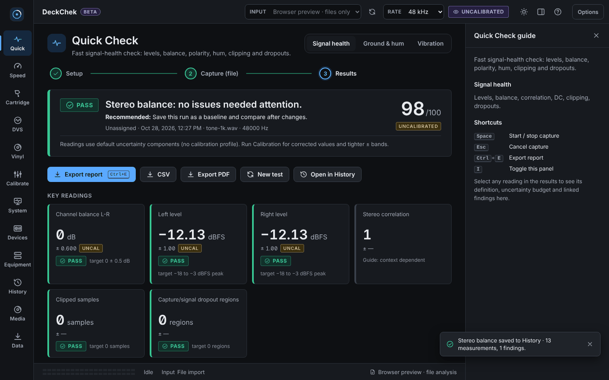
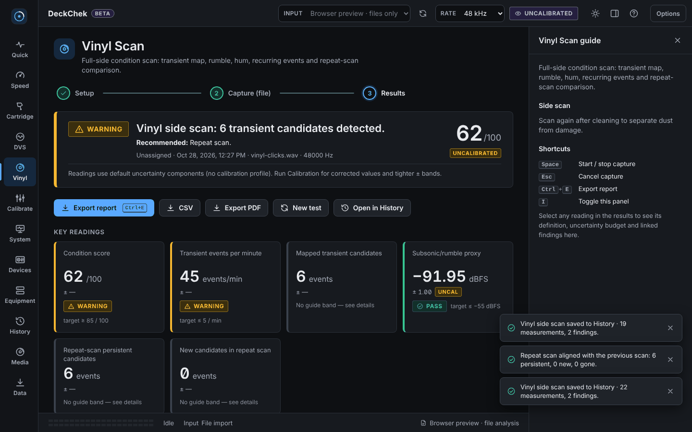
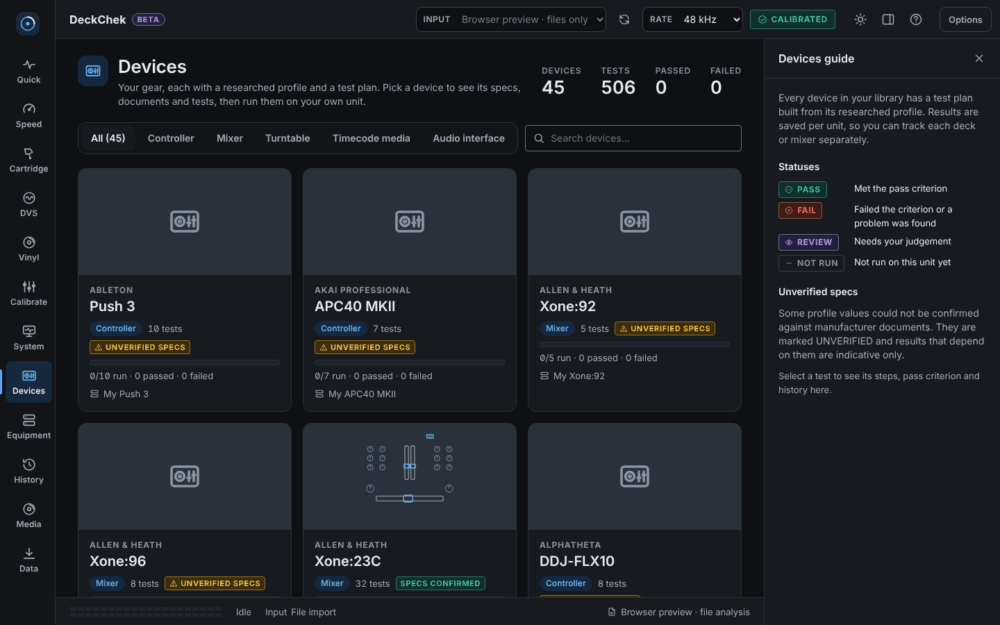

# DeckChek

DeckChek is a cross-platform DJ hardware diagnostic workstation for DJs, technicians, collectors, repair shops, rental fleets, and performers. Its planned editions cover vinyl, CDJs/media players, DJ controllers, and technician/engineering workflows, with an Ultimate edition combining all four. The separate MIDI Tester remains a free MIDI diagnostics tool.

DeckChek is not a music player or DJ application. Its job is to measure, compare, diagnose, trend, and document DJ playback hardware and signal paths.

## Screenshots

Captured from the browser shell (file-analysis mode) with `tools/ui-smoke.mjs`, using bundled synthetic test audio.







## Product goals

DeckChek should answer questions such as:

- Is this turntable actually running at the correct speed?
- Is the pitch fader linear and calibrated across its range?
- Are the left and right channels balanced?
- Is azimuth or cartridge alignment probably wrong?
- Is a hum problem coming from grounding, cabling, the cartridge, the mixer, or the audio interface?
- Is the deck vulnerable to booth vibration or acoustic feedback?
- Does a DVS control record still track reliably?
- Where on a control record is the timecode worn or damaged?
- Where on a conventional record are probable scratches, repeating clicks, groove damage, mistracking, non-fill, surface contamination, or abnormal noise?
- Are two decks well matched?
- Has a specific deck, cartridge, or venue setup degraded since its last baseline?
- How does this cartridge/turntable/mixer/interface combination compare with other measured combinations?
- Which venue surface or booth arrangement has historically produced the best vinyl stability?
- Does a CDJ or media player hold speed, read reference media consistently, and produce clean outputs?
- Are a controller's faders, encoders, jogs, pads, buttons, and MIDI/HID messages behaving consistently?
- Do the controller's audio outputs and routing pass a repeatable signal-path check?

## Proposed product editions

- MIDI Tester — Free: standalone MIDI monitor and basic controller diagnostic tool; current capabilities are listed in its own section in SPEC-11.
- DeckChek Vinyl: turntables, cartridges, records, vinyl DVS, and vinyl-oriented venue tests.
- DeckChek CDJ / Media Player: CDJs, file players, transport, pitch, outputs, media and CD/file DVS.
- DeckChek Controller: DJ controllers, all-in-one systems, motorized control surfaces and supported audio paths.
- DeckChek Technician / Engineering: service-bench diagnostics, generated reference signals, calibration worksheets, fault isolation, repair verification and engineering comparisons across supported turntables, CDJs and controllers.
- DeckChek Ultimate: all four paid DeckChek editions.

The complete proposed edition boundaries and test coverage are in [SPEC-11 Product Editions and Diagnostic Categories](docs/SPEC-11-product-editions-and-categories.md). Device records are capability-based, so hybrid and all-in-one systems can appear in multiple categories.

## CDJ / media-player diagnostics under consideration

The [CDJ consideration backlog](docs/SPEC-10-CDJ-media-player-diagnostics.md) retains 30 proposed diagnostic and comparison ideas, with recommended v1.0, v2.0 and later scope. The proposed first release reuses pitch mapping, stereo Quick Check, generic CD/file timecode analysis, local player records and comparison reports. Advanced transport, optical-media, cue/jog and digital-output tests are staged separately. These are recommendations, not implemented features or release commitments.

## Implementation direction

Preferred stack:

- Core DSP and measurement engine: Rust
- Desktop shell: Tauri
- UI: TypeScript + HTML/CSS
- Audio I/O: CPAL or equivalent native Rust abstraction
- FFT: rustfft
- Resampling: rubato or equivalent
- Database: SQLite
- Serialization: JSON
- Reports: HTML first, then PDF export
- Optional WebAssembly modules for reusable analysis components

No Python, PowerShell, or JUCE is required.

## Specification index

- [SPEC-00 Product Architecture](docs/SPEC-00-product-architecture.md)
- [SPEC-01 Turntable and Cartridge Diagnostics](docs/SPEC-01-turntable-cartridge-diagnostics.md)
- [SPEC-02 DVS and Timecode Diagnostics](docs/SPEC-02-dvs-timecode-diagnostics.md)
- [SPEC-03 Full-Side Vinyl Condition Scan](docs/SPEC-03-vinyl-condition-scan.md)
- [SPEC-04 Hardware, Timecode, and Setup Database](docs/SPEC-04-comparison-database.md)
- [SPEC-05 Venue, Surface, and Feedback Diagnostics](docs/SPEC-05-venue-surface-diagnostics.md)
- [SPEC-06 Scoring, Diagnostic Reasoning, and Reports](docs/SPEC-06-scoring-reasoning-reports.md)
- [SPEC-07 Data Model and Local API](docs/SPEC-07-data-model-api.md)
- [SPEC-08 Test Methodology and Validation](docs/SPEC-08-test-methodology.md)
- [SPEC-09 Implementation Roadmap](docs/SPEC-09-roadmap.md)
- [SPEC-10 CDJ and Media-Player Diagnostics — Consideration Backlog](docs/SPEC-10-CDJ-media-player-diagnostics.md)
- [SPEC-11 Product Editions and Diagnostic Categories](docs/SPEC-11-product-editions-and-categories.md)
- [SPEC-12 Missing-Spec Capability Map](docs/SPEC-12-capability-map.md)
- [SPEC-13 GUI and User Experience](docs/SPEC-13-gui-ux.md)
- [SPEC-14 Audio Routing and Physical Wiring](docs/SPEC-14-audio-routing-and-wiring.md)
- [SPEC-15 Inputs, Outputs, and Data Flow](docs/SPEC-15-input-output-and-data-flow.md)
- [SPEC-16 End-to-End Workflows and Functional Behavior](docs/SPEC-16-workflows-and-functional-behavior.md)
- [SPEC-17 Operational Quality, Privacy, and Release Readiness](docs/SPEC-17-operational-quality.md)
- [Feature Implementation Matrix](docs/FEATURE-MATRIX.md)
- [Implementation Status](docs/IMPLEMENTATION-STATUS.md)
- [Research Notes and Sources](docs/RESEARCH.md)

## Design principles

DeckChek must preserve raw evidence separately from conclusions. A transient event is not automatically a scratch. A channel imbalance is not automatically a bad cartridge. A malformed DVS scope is not automatically a worn control record.

Every finding therefore has:

- measured evidence;
- analysis method;
- confidence;
- severity;
- possible causes;
- alternative explanations;
- suggested isolation tests;
- whether the result is direct measurement, inferred diagnosis, or user-entered metadata.

DeckChek should prefer repeatable measurements over opaque scores. Scores exist as summaries, but every score must be drillable into the underlying measurements.

## Status

DeckChek is a beta (desktop version 0.0.8 in `src-tauri/tauri.conf.json`). The Windows desktop shell supports continuous native audio capture, live meters, loopback calibration with uncertainty propagation, SQLite catalog persistence, a device library with per-unit test plans, and deterministic evidence-first diagnostics. Files can also be analyzed in a plain browser; results export as HTML, PDF, CSV and JSON. Shipped milestones include the first-run wizard, diagnostics bundle, PDF export, test-media library and backup/restore (M5), plus M6 features (pre-gig check, latency/buffer tuner, stylus wear, control-vinyl wear map, scratch stress test, hum/feedback hunter) that are behind experimental feature flags, and a mobile companion PWA in `mobile/`. Real-hardware validation is still pending, installers are unsigned and there is no auto-update.

See [Implementation Status](docs/IMPLEMENTATION-STATUS.md) for the current code/spec reconciliation and [TODO.md](TODO.md) for the build queue.

## Run and test

```
npm test                      # 830 node:test checks (tests/*.test.mjs)
```

To try the UI without Tauri, serve `app/` over HTTP (for example `python3 -m http.server -d app 8080`) and open it in a browser. For the desktop shell, Rust checks and the Playwright smoke test see [BUILDING.md](BUILDING.md).

## Project layout

- `app/` - vanilla ES-module front end and pure measurement code ([app/README.md](app/README.md))
- `mobile/` - DeckChek Mobile companion PWA
- `src-tauri/` - Rust/Tauri 2 desktop shell, native capture and SQLite
- `database/` - SQL migrations and seed data
- `shared/`, `tools/` - shared scripts and build/smoke tooling
- `tests/` - JavaScript regression tests
- `docs/` - specifications, research, status and test scripts

## License

Proprietary, all rights reserved; see [LICENSE](LICENSE) and [COPYRIGHT-TRADEMARK.md](COPYRIGHT-TRADEMARK.md).

## Builds and release status

The cross-platform validation workflow targets Windows x64 and x86, macOS Intel and Apple silicon, and Linux x64 and x86. Tag builds publish a prerelease with checksums only after all automated build and test jobs pass. A configured target means a build is attempted; it does not establish OS audio-driver support or physical hardware validation. See [Cross-Platform Release Acceptance](docs/CROSS-PLATFORM-RELEASE-ACCEPTANCE.md) and [Implementation Status](docs/IMPLEMENTATION-STATUS.md) for verified artifacts and known limits.

## Additional engineering research

- [Comparable open source projects and reuse decisions](docs/OPEN-SOURCE-RESEARCH.md)
- [Scientific journals, books and measurement evidence](docs/SCIENTIFIC-RESEARCH.md)
- [SPEC-18 Open Source Reuse and Validation](docs/SPEC-18-open-source-reuse-and-validation.md)
- [SPEC-19 Scientific Measurement and Validation](docs/SPEC-19-scientific-measurement-and-validation.md)
- [SPEC-20 Audio Output Test Signals and Format Fixtures](docs/SPEC-20-audio-output-test-signals.md)
- [Cross-Platform Release Acceptance](docs/CROSS-PLATFORM-RELEASE-ACCEPTANCE.md)

These documents define candidates and validation requirements. Dependencies, detectors and standards conformity remain unimplemented until verified; research additions do not change the product license.

## Possible future features

The [service-bench consideration backlog](docs/POSSIBLE-FUTURE-FEATURES.md) records 49 proposed turntable, CDJ and controller workflows, plus deferred instrument-assisted engineering tests. It includes software-generated tones, multimeter worksheets, microphone and phone-video comparisons, CDJ service-result/CSV imports and controller checks, with equipment requirements, measurement limits, source links and validation gates. These are future candidates, not implemented capabilities or beta dependencies.

## Tests (verified on this snapshot)

`npm test` (Node built-in test runner, `tests/*.test.mjs`) ran 823 tests: 820 passed and 3 failed. The three failures are in `tests/device-library.test.mjs` (the `loadProfiles`, `groupTestsByCategory, specSummary and progressFor`, and catalog-store device-result tests). They were not investigated in this documentation pass, so treat the suite as not fully green.

## Wiki

Wiki source pages are in [docs/wiki/](docs/wiki/Home.md): developer guide, architecture rationale and codebase map. `docs/IMPLEMENTATION-STATUS.md` is the current code and spec reconciliation.
